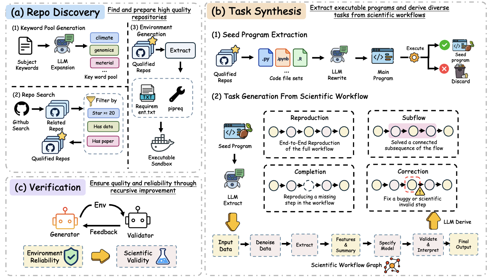

# POSEIDON

**Paper: _POSEIDON: Scaling Training Environments for Scientific Agents from Code Repositories_**

POSEIDON turns scientific code repositories into executable, verifiable environments for training scientific agents. It discovers research repositories, extracts runnable workflows, and derives four complementary task families: **Reproduction**, **Subflow**, **Completion**, and **Correction**. Reference answers come from program execution, while a verification and repair loop checks the resulting tasks, evaluators, and environments.

The paper introduces **PEARL**, a collection of **97,659 environments** from **7,110 public repositories** across **10 scientific disciplines**. This anonymous release contains the environment-generation pipeline; the commands below generate tasks from your own source repositories.



## Quick start

Use Python 3.10+ on Linux with `venv` and `pip` available. Run commands from this directory. Repository-specific scientific dependencies are installed during environment setup; Git is needed for repository mining and Docker for building task images.

### 1. Install and configure

```bash
python3 -m venv .venv
source .venv/bin/activate
python -m pip install -r requirements.txt
cp .env.example .env
```

Fill in `STEM_GW_URL`, `STEM_GW_MODEL`, and `STEM_GW_KEY` for generation, and `STEM_QC_URL`, `STEM_QC_MODEL`, and `STEM_QC_KEY` for verification. URLs must be full chat-completion endpoints; the default protocol uses OpenAI-compatible bearer authentication. Then export `.env` into your shell (the code does not load it automatically):

```bash
set -a
source .env
set +a
```

See [.env.example](.env.example) for the available settings. Replace every `/path/to` placeholder with your local location. Generation and packaging both make model requests, so configure both services before running.

### 2. Prepare source workflows

Place source repositories under a common directory and provide a JSONL index with one record per scientific source file. `file_path` is relative to the repository collection root, including the repository directory; `code` contains that file's source text. For example, given `example_repo/analysis.py` and its input data:

```bash
export STEM_STAGE1_REPOS=/path/to/repositories
export STEM_STAGE1_JSONL=/path/to/scientific_python_files.jsonl

python - <<'PY'
import json
import os
from pathlib import Path

root = Path(os.environ["STEM_STAGE1_REPOS"])
source = root / "example_repo" / "analysis.py"
record = {
    "file_path": source.relative_to(root).as_posix(),
    "code": source.read_text(encoding="utf-8"),
    "is_scientific_coding_task": "Yes",
    "discipline": "biology",
}
Path(os.environ["STEM_STAGE1_JSONL"]).write_text(
    json.dumps(record) + "\n", encoding="utf-8"
)
PY
```

Use a real workflow and its required data in place of this example. Repository discovery and index construction scripts are also provided in [mining/](mining/), with bundled keyword lists in [mining/keywords/](mining/keywords/).

### 3. Generate and verify tasks

Start with one repository and one seed:

```bash
python -m stemgen.orchestrator \
  --seeds all \
  --difficulty off \
  --require-real-data \
  --repo-limit 1 \
  --max-seeds 1 \
  --per-type 1 \
  --run-name demo
```

The pipeline prepares dependencies, adapts and executes source workflows, generates task variants and evaluators, and packages candidates that pass reproduction and QC checks. `--require-real-data` excludes seeds without available inputs. `--difficulty off` skips optional agent difficulty grading, whose external grader/agent integrations are not bundled; execution verification and packaging QC remain enabled. Resume is enabled by default.

Results are written under `tasks_out/demo/`: `candidates.jsonl` stores generated candidates, `report.json` records processing outcomes, and `packaged/` contains accepted tasks, rejection/pending folders, and an index. Each accepted task includes `task.md`, `gold_program.py`, `eval_script.py`, `dockerfile`, and `data/`, plus incomplete or buggy code where applicable. Remove the two limit flags to process the full index; use `--help` for concurrency and timeout options.

## Code layout

| Directory | Purpose |
|---|---|
| `stemgen/` | Workflow extraction, task synthesis, execution, evaluation, and packaging |
| `mining/` | Repository discovery and scientific source-file collection |
| `pool_and_launch/` | Repository pools and distributed launch templates |
| `qc/` | Three-round model QC, independent audit sampling, and task-image building |
| `collect/`, `datasets/` | Collect generated tasks and assemble dataset subsets |
| `docs/`, `tests/` | Pipeline documentation and local validation |

Distributed launch and collection scripts require deployment-specific paths and host settings. The local workflow above does not require those services.

### Independent audit

After packaging, create the paper-aligned 600-task audit manifest with `python qc/manual_audit.py tasks_out/demo/packaged/tasks_with_id.jsonl audit.json --sample-size 600`. Reviewers should submit JSONL rows with `task_id` and `approved`; pass `--reviews reviews.jsonl` to compute the all-three-reviewers acceptance rate.
